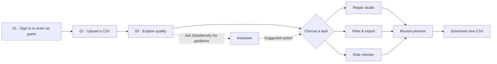

<div align="center">

# ✦ DataMendry

### A modern data repair studio for cleaner, more reliable CSV files

**Explore data · Detect problems · Preview fixes · Export with confidence**

[](https://datamendry-demo.onrender.com/)
[](https://github.com/harshsinghps57-spec/datamendry)

[](https://github.com/harshsinghps57-spec/datamendry/actions/workflows/tests.yml)


[](LICENSE)

**[🌐 Live Website](https://datamendry-demo.onrender.com/)** · **[📚 Developer API](https://datamendry-demo.onrender.com/api/docs)** · **[🐙 Source Repository](https://github.com/harshsinghps57-spec/datamendry)**

</div>

---

## About DataMendry

**DataMendry** is an open-source web application for profiling, inspecting, filtering and preparing repairs to messy CSV datasets. It helps you understand what needs attention, preview the impact of changes and export a separate result—**without silently overwriting your original file**.

Built for students, analysts, researchers and teams who want a straightforward way to review CSV quality without editing source files blindly.

> [!TIP]
> **Try it now:** [Open DataMendry](https://datamendry-demo.onrender.com/) → **Explore as guest** → **Try sample dataset**. No account is required for the sample workflow.

## Features

| Feature | What it does |
| --- | --- |
| **Overview** | Upload a CSV or open the sample dataset; see a high-level profile. |
| **Quality explorer** | Inspect columns, missing cells, duplicates and data-quality findings. |
| **Repair studio** | Preview deterministic cleanup operations such as trimming whitespace, normalizing blanks and removing exact duplicates. |
| **Rule checker** | Run read-only column validations for required, unique, numeric and min/max rules. |
| **Filter & export** | Filter rows, choose which columns to keep, preview the matching data and download a separate CSV. |
| **Ask DataMendry** | Use a guided assistant to translate common cleanup requests into safe, reviewable suggestions. Optional connected AI requires separate configuration and consent. |
| **My Datasets** | Sign in with email/password or Google and save original CSV files in private Supabase Storage. |
| **Guided experience** | Animated entry, section navigation, account menu and an in-app **How it works** tour. |

**Designed for review:** Nothing is silently applied to the stored original. Repair and filtering operations generate a new export after a preview.

## How it works



The **How it works** page also offers a guided tour of the main features. Signed-in users can return to account-saved originals via **My Datasets**; guest processing workspaces are temporary.

## Technology stack

| Layer | Technology |
| --- | --- |
| Frontend | HTML, CSS, JavaScript |
| API / backend | Python, FastAPI, Uvicorn |
| CSV processing | Python CSV module and disk-backed SQLite workspaces |
| Authentication | Supabase Auth — email/password, email recovery and Google OAuth |
| Saved original files | Supabase Storage with per-user row-level security policies |
| Hosting | Render |
| Automated tests | pytest and GitHub Actions |

## Run locally

**Requirements:** Python 3.11+ and Git.

### 1. Clone the repository

```powershell
git clone https://github.com/harshsinghps57-spec/datamendry.git
cd datamendry
python -m venv .venv
.\.venv\Scripts\Activate.ps1
python -m pip install -r requirements-dev.txt
```

These examples use **Windows PowerShell**. On macOS/Linux, activate using `source .venv/bin/activate`.

### 2. Start the app

```powershell
$env:DATAMENDRY_DEMO_ONLY = "0"
python -m uvicorn datamendry.api:app --host 127.0.0.1 --port 8002
```

Visit **http://127.0.0.1:8002/**. The default mode restricts arbitrary CSV uploads; `DATAMENDRY_DEMO_ONLY=0` enables uploads for trusted local development.

### 3. Optional: configure Supabase accounts and storage

For account login and **My Datasets**, configure an existing Supabase project with the appropriate Auth providers and a **private** Storage bucket called `datamendry-files`. Review [`SUPABASE_SETUP_v0.6.sql`](SUPABASE_SETUP_v0.6.sql) for the intended per-user access policies.

Set the following variables for local development:

```powershell
$env:DATAMENDRY_SUPABASE_URL = "https://YOUR-PROJECT.supabase.co"
$env:DATAMENDRY_SUPABASE_PUBLISHABLE_KEY = "sb_publishable_YOUR_KEY"
```

Restart the server after configuring environment variables. Configure the Google OAuth client secret **inside Supabase**, not in this repository. Never commit a Supabase secret/service-role key, a password, personal datasets or other private credentials.

## Tests and continuous integration

```powershell
python -m pytest -q
```

The [GitHub Actions test workflow](https://github.com/harshsinghps57-spec/datamendry/actions/workflows/tests.yml) runs the suite using Python 3.11, 3.12 and 3.13. Tests cover API functionality, dataset processing, account integration, filters, assistant planning and interface contracts.

## Live demo and deployment

- **Live website:** https://datamendry-demo.onrender.com/
- **Source repository:** https://github.com/harshsinghps57-spec/datamendry
- **Developer API:** https://datamendry-demo.onrender.com/api/docs
- **Render configuration:** [`render.yaml`](render.yaml)

The checked-in Render configuration provides a controlled public beta with an **8 MiB** temporary upload limit and limits on dataset size and request rates. Render Free instances may take time to wake after inactivity, and their local filesystem is ephemeral. Temporary guest workspaces may expire or be lost on restart. Signed-in users' saved original files live separately in Supabase Storage, subject to Supabase's quotas and retention policies.

> [!IMPORTANT]
> **Public beta / privacy:** Use nonsensitive sample or test CSVs. The app has **not undergone an independent security audit** and is not intended for confidential, regulated or sensitive personal information. Review [`SECURITY.md`](SECURITY.md) for the security model and remaining risks.

## Repository structure

```text
datamendry/
├── datamendry/               # FastAPI, CSV engine, filters, assistant planner
├── static/                   # Frontend, account interface and animations
├── tests/                    # Automated tests
├── examples/                 # Example materials
├── benchmarks/               # Performance experiments
├── .github/workflows/        # GitHub Actions CI
├── render.yaml               # Render service configuration
├── SUPABASE_SETUP_v0.6.sql   # Reference for private storage policies
├── requirements.txt          # Runtime dependencies
└── README.md
```

## Roadmap

Possible future improvements include richer data visualizations, advanced data-quality reporting, more expressive filtering, reusable cleaning recipes and a more capable consent-driven AI assistant. These are **future goals**, not current features.

## Contributing and license

Issues, suggestions and pull requests are welcome. Read [`CONTRIBUTING.md`](CONTRIBUTING.md) before contributing and [`SECURITY.md`](SECURITY.md) before reporting security vulnerabilities.

DataMendry is distributed under the [MIT License](LICENSE).

---

<div align="center">

**DataMendry — Clean with confidence. Your original remains yours.**

[**🚀 Open the live app**](https://datamendry-demo.onrender.com/) · [Report an issue](https://github.com/harshsinghps57-spec/datamendry/issues)

</div>
